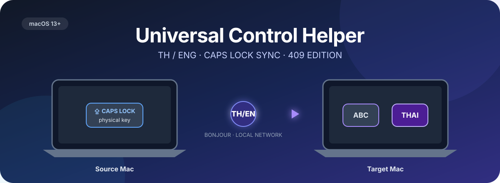

<p align="center">
  
</p>

<h1 align="center">Universal Control Helper · 409 TH/ENG Edition</h1>

<p align="center">
  <strong>กด Caps Lock บน MacBook แล้วสลับภาษาไทย / อังกฤษบน Mac mini ได้อีกครั้ง</strong><br />
  <sub>Keep Thai / English input sources in sync across Macs using Apple Universal Control.</sub>
</p>

<p align="center">
  <a href="https://github.com/Gaparamet/universal-control-helper/actions/workflows/ci.yml"></a>
  <a href="https://github.com/Gaparamet/universal-control-helper/releases"></a>
  <a href="LICENSE"></a>
  
</p>

> [!IMPORTANT]
> **409 TH/ENG Edition** เป็นการดัดแปลงจาก [Universal Control Helper โดย feelgom](https://github.com/feelgom/universal-control-helper) เพื่อรองรับการใช้งาน **Thai ↔ English** และ UI ภาษาไทย/อังกฤษ ขอบคุณ [@feelgom](https://github.com/feelgom) สำหรับต้นฉบับโอเพนซอร์สภายใต้ [MIT License](LICENSE) (สงวนประกาศลิขสิทธิ์เดิม)
>
> **Latest stable: [v1.5.5 — 409 Edition](https://github.com/Gaparamet/universal-control-helper/releases/tag/v1.5.5).** ดาวน์โหลด ZIP ที่พร้อมใช้งานได้เลย ไม่ต้อง Compile หรือ Build แอปเอง รองรับ macOS 13+ และติดตั้งบน Mac ทั้งสองเครื่อง โดย **ปิด Auto-update ชั่วคราว**; อัปเดตผ่านหน้า Releases เท่านั้น

## 🇹🇭 ทำไมต้องมีตัวนี้?

ถ้าใช้ **Universal Control** ลากเคอร์เซอร์และคีย์บอร์ดจาก MacBook ไปยัง Mac mini บางครั้งการกด **Caps Lock เพื่อสลับภาษา** จะไม่ทำงานบนเครื่องปลายทาง และกลายเป็นการเปิด/ปิด Caps Lock แทน

Universal Control Helper ตรวจจับการกด Caps Lock จาก **คีย์บอร์ดจริงบน Source Mac** แล้วส่งสัญญาณไปให้ **Target Mac** เปลี่ยน Input Source ผ่านเครือข่ายภายใน พร้อมซิงค์สถานะภาษาเมื่อมีการเปลี่ยน Input Source บน Source

```text
MacBook / Source                   Mac mini / Target
Physical Caps Lock ── Bonjour / LAN ──▶ Thai ↔ ABC
     TH / ENG state ────────────────▶ sync language
```

### ความสามารถ

- 🇹🇭 **Thai / English:** รองรับ Thai (รวม Kedmanee / Pattachote ที่ macOS ระบุเป็น Thai) และ ABC / U.S.
- ⇪ **Caps Lock relay + Source neutralization (v1.5.5):** ส่งคำสั่งสลับภาษาไปยัง Target และดับ Caps Lock บน Source ทันทีหลังถูกกด เพื่อไม่ให้ Universal Control คัดลอกสถานะ Caps Lock ที่ค้างไปทับบน Target
- 🔄 **Input source synchronization:** ซิงค์สถานะภาษาจาก Source ไป Target เมื่อทั้งสองฝั่งใช้รุ่นที่รองรับ
- 🛡️ **Target Caps Lock guard:** ตรวจสถานะผ่าน IOKit + Quartz และลดการทำงานของ Timer ซ้ำซ้อน
- 🔌 **Connection reliability:** TCP keepalive, timeout, retry แบบ backoff และสถานะ Pairing Code ไม่ตรงที่แสดงค้างให้อ่านได้
- 🪟 **Quieter launch:** หน้าต่าง Settings เปิดเองเฉพาะครั้งแรกหรือเมื่อ Source ยังไม่ได้สิทธิ์ Input Monitoring
- 🌐 **Thai / English UI:** เลือกภาษาหน้าต่าง Settings และ Menu Bar ได้
- 🔗 **Local pairing:** ค้นหาผ่าน Bonjour และจับคู่ด้วยรหัส 6 หลัก
- 🇰🇷 ยังคงรองรับ Korean 2-set จากโปรเจกต์ต้นทางเมื่อมี Input Source ที่เหมาะสม

## ดาวน์โหลดและติดตั้ง · v1.5.5

**ใช้แอปสำเร็จรูปได้เลย ไม่ต้อง Compile / Build / รัน Shell Script**

ดาวน์โหลดจาก [Release v1.5.5](https://github.com/Gaparamet/universal-control-helper/releases/tag/v1.5.5) แล้วเลือก ZIP **หนึ่งไฟล์** (ไม่ต้องโหลดทั้งสองชื่อ):

- **[UniversalControlHelper-1.5.5-TH-ENG.zip](https://github.com/Gaparamet/universal-control-helper/releases/download/v1.5.5/UniversalControlHelper-1.5.5-TH-ENG.zip)** — ไฟล์ที่แนะนำ
- [UniversalControlHelper-macOS-universal.zip](https://github.com/Gaparamet/universal-control-helper/releases/download/v1.5.5/UniversalControlHelper-macOS-universal.zip) — ชื่อไฟล์ Universal ทางเลือก
- [SHA256SUMS](https://github.com/Gaparamet/universal-control-helper/releases/download/v1.5.5/SHA256SUMS) — Checksums สำหรับตรวจความถูกต้องของไฟล์

**ติดตั้งบน Mac ทั้งสองเครื่อง:**

1. ดาวน์โหลด ZIP จากลิงก์ข้างบนและแตกไฟล์
2. ย้าย `Universal Control Helper.app` เข้าโฟลเดอร์ `Applications` ของ Mac **ทั้ง Source และ Target**
3. เปิดแอปจาก `Applications`; หาก macOS เตือนเกี่ยวกับแอปที่ดาวน์โหลด ให้ตรวจสอบว่าดาวน์โหลดจาก Release นี้จริงและใช้คำแนะนำใน **System Settings → Privacy & Security** แทนการปิด Gatekeeper ทั้งระบบ
4. ตั้งค่า **Source / Target**, จับคู่รหัส 6 หลัก และให้ Permissions ตามหัวข้อถัดไป

> [!NOTE]
> **การอัปเดต:** รุ่นนี้ปิด Sparkle Auto-update ชั่วคราว เพราะ Feed/Key เดิมมาจากโปรเจกต์ต้นทาง หากมีรุ่นใหม่ ให้ดาวน์โหลด ZIP จาก [409 Releases](https://github.com/Gaparamet/universal-control-helper/releases) และติดตั้งแอปเวอร์ชันใหม่ด้วยตัวเอง (ไม่ต้อง Compile) บิลด์ปัจจุบันลงนามแบบ **ad-hoc**; หลังอัปเดต macOS อาจขอสิทธิ์ Input Monitoring หรือ Local Network อีกครั้ง

### ตรวจสอบไฟล์ดาวน์โหลด (แนะนำ)

ตรวจ SHA-256 ของ ZIP ที่ดาวน์โหลด แล้วเทียบกับบรรทัดชื่อไฟล์เดียวกันใน `SHA256SUMS` ที่หน้า Release:

```bash
shasum -a 256 ~/Downloads/UniversalControlHelper-1.5.5-TH-ENG.zip
```

หากดาวน์โหลด ZIP ชื่อ `UniversalControlHelper-macOS-universal.zip` ให้เปลี่ยนชื่อไฟล์ในคำสั่งให้ตรงกับที่ดาวน์โหลด

### ตั้งค่า Source / Target

1. เปิด **Apple Universal Control** บน Mac ทั้งสอง และเชื่อมต่อบน **LAN ที่เชื่อถือได้** เดียวกัน
2. เปิด Universal Control Helper ทั้งสองเครื่อง เลือก **Source** บน Mac ที่ใช้คีย์บอร์ดจริง และ **Target** บน Mac ที่รับคีย์บอร์ดผ่าน Universal Control
3. ใช้ **Pairing Code 6 หลัก** ที่ Source แสดง กรอกบน Target
4. อนุญาต **Input Monitoring บน Source** และ **Local Network บนทั้งสอง Mac** ตามที่ macOS ขอ (Target ไม่ต้องใช้ Input Monitoring สำหรับการทำงานปกติ)
5. ที่ Target ตั้ง Input Sources เช่น **Thai** และ **ABC / U.S. / British** ตามที่ต้องการใน System Settings → Keyboard → Text Input
6. เลื่อนเคอร์เซอร์จาก Source ไป Target ผ่าน Universal Control แล้วทดสอบ Caps Lock เพื่อสลับภาษา

> Settings จะเปิดอัตโนมัติเฉพาะการเปิดแอปครั้งแรก หรือเมื่อ Source ยังขาด Input Monitoring เท่านั้น; สามารถเปิด Settings เองภายหลังได้

### สิ่งที่เปลี่ยนใน v1.5.5

- **แก้ Caps Lock ค้างที่ Source และ Target:** Source ดับ Caps Lock ของตัวเองทันทีหลังจับการกด; Target ตรวจผ่าน IOKit และ Quartz เพื่อป้องกันสถานะที่ Universal Control ส่งซ้ำ
- **ผลทดสอบของผู้พัฒนา:** ทดสอบสลับภาษา 141 ครั้งบน MacBook Air + Mac mini โดยไม่พบอาการค้าง; ช่วงที่ Caps Lock ติดชั่วคราวสูงสุดที่วัดได้คือ **137 ms** — ไม่ใช่การรับประกันผลลัพธ์บนทุกเครื่อง
- **Connection ทนขึ้น:** เพิ่ม TCP keepalive, connection/verification timeout และ retry ด้วย backoff พร้อมรักษาข้อความเมื่อ Pairing Code ไม่ตรง
- **UI กระชับขึ้น:** Settings ไม่เปิดทับทุกครั้ง; สวิตช์ป้องกัน Caps Lock ค้างปรากฏเฉพาะโหมด Target และรองรับการจับคู่ English Input Source แบบ British/U.S. เมื่อไม่มี ABC
- **Diagnostics สำหรับผู้ใช้ขั้นสูง:** เพิ่ม `os.Logger` subsystem `co.409.uch` และตัววัด Caps Lock / Backspace แบบ Opt-in (ปิดไว้ตามปกติ)

### Caps Lock บน Source: ข้อแลกเปลี่ยน

เมื่อเปิดการแก้ Caps Lock ค้างของ v1.5.5 การ **กด Caps Lock ค้างเพื่อพิมพ์ตัวใหญ่บน Source จะใช้ไม่ได้** ระหว่าง Helper ทำงาน หากต้องการกลับไปใช้พฤติกรรมเดิม สามารถปิดการป้องกันที่ Source ได้ด้วยคำสั่งขั้นสูงนี้:

```bash
defaults write io.yoonsungji.UniInputFix sourceClearsCapsLock -bool NO
```

หลังเปลี่ยนค่า ให้ปิดแล้วเปิดแอปใหม่เพื่อให้แน่ใจว่าค่าใหม่ถูกโหลด และหากต้องการเปิดการป้องกันกลับ ใช้คำสั่งเดียวกันโดยเปลี่ยน `NO` เป็น `YES`

### Troubleshooting & known limitations

| อาการ / ข้อจำกัด | สิ่งที่ควรรู้หรือทดลอง |
| --- | --- |
| Caps Lock ยังไม่สลับภาษา | ตรวจ Input Monitoring บน Source, Input Source ที่ Target, บทบาท Source/Target และสถานะการเชื่อมต่อ |
| Caps Lock บน Target ติดตัวพิมพ์ใหญ่ชั่วคราว | รุ่นนี้ลดอาการค้างได้มาก แต่มีช่วงสั้น ๆ หลังการกดที่อาจเกิดขึ้น (ผลทดสอบสูงสุดราว 140 ms) |
| Backspace บน Target ลบสองตัวบางครั้ง | **ยังเป็น Known Issue**; การวัด 227 ครั้งไม่พบเหตุการณ์ปุ่มซ้ำที่ได้รับบน Target จึงยังไม่ควรระบุว่าแก้ได้แล้ว |
| เชื่อมต่อไม่ติด / รหัสไม่ตรง | ตรวจ LAN ที่เชื่อถือได้, Local Network Permission, Pairing Code และลองจับคู่ใหม่ |
| เปิดแอปแล้ว Settings ไม่ขึ้น | เป็นพฤติกรรมปกติหลังตั้งค่าแล้ว; เปิด Settings เองจากแอปหากต้องการแก้การตั้งค่า |
| อัปเดตแล้ว Permissions หาย | บิลด์ ad-hoc อาจต้องให้สิทธิ์ Input Monitoring / Local Network ใหม่ใน Privacy & Security |
| ต้องการ Log เพิ่ม | สำหรับการวินิจฉัยขั้นสูงเปิดด้วย `defaults write io.yoonsungji.UniInputFix diagnosticsEnabled -bool YES`; ปิดกลับด้วย `-bool NO` — เมื่อเปิด Diagnostics บน Target อาจต้องให้ Input Monitoring เพิ่ม |

> [!WARNING]
> **อย่าใช้ Installer Script เก่าที่พบใน Source หรือ Release รุ่นก่อนเพื่ออัปเดต 409 Edition** เพราะสคริปต์ใน Repository ปัจจุบันยังอ้างอิง ZIP จากโปรเจกต์ต้นทาง ทางติดตั้งที่รองรับสำหรับผู้ใช้ทั่วไปคือ **ดาวน์โหลด ZIP จาก 409 v1.5.5 โดยตรง**

## ความเป็นส่วนตัวและเครือข่าย

แอปออกแบบให้ส่งเฉพาะสัญญาณสลับภาษาและสถานะ Input Source ที่รองรับ ไม่ได้ออกแบบให้ส่งข้อความที่พิมพ์ คลิปบอร์ด หรือเมาส์ผ่าน Relay ของแอป อย่างไรก็ตาม **Source ต้องได้รับสิทธิ์ Input Monitoring** เพื่อดูเหตุการณ์ของคีย์บอร์ดจริง

**รหัสจับคู่ไม่ใช่ระบบเข้ารหัสการสื่อสาร** จึงควรใช้เฉพาะ LAN ที่เชื่อถือได้ ไม่ควรใช้บนเครือข่ายสาธารณะหรือเครือข่ายที่ไม่ไว้วางใจ

## For English readers

**Universal Control Helper — 409 TH/ENG Edition v1.5.5** is a macOS menu-bar utility adapted from [feelgom/universal-control-helper](https://github.com/feelgom/universal-control-helper). It keeps supported Thai / English keyboard input sources synchronized between two Macs using Apple Universal Control.

**Download — no compilation required:** Get [v1.5.5 on GitHub Releases](https://github.com/Gaparamet/universal-control-helper/releases/tag/v1.5.5), download **one** of the two ready-to-use ZIP assets, unzip, and move `Universal Control Helper.app` into `Applications` on **both** Macs. The ZIPs and `SHA256SUMS` are published with the release.

**Setup:** Requires macOS 13+, Apple Universal Control, a shared trusted LAN, Source Input Monitoring permission, Local Network permission on both Macs, matching 6-digit pairing codes, and configured Thai + English input sources. Use Source on the Mac with the physical keyboard and Target on the other.

**v1.5.5 highlights:** Source-side Caps Lock neutralization to prevent stuck uppercase on Target; combined IOKit/Quartz Caps Lock checks; TCP keepalive, connection and pairing timeouts, backoff retries; quieter Settings startup; British/U.S. English layout fallback; optional privacy-limited diagnostics.

**Important:** Automatic Sparkle updates are disabled for the 409 Edition for now. Install updates from the 409 Releases page manually. Current builds are ad-hoc signed and may prompt for permissions after updating. Source-side Caps Lock neutralization prevents holding Caps Lock for uppercase while the helper is active (opt out using the command in the Thai section). Brief transient uppercase on Target and occasional duplicate Backspace deletion remain known limitations. The six-digit pairing code does not provide end-to-end encryption; use trusted local networks only.

## Development & attribution

สำหรับผู้พัฒนาที่ต้องการทดสอบหรือ Build จาก Source โดยสมัครใจ ดู [RELEASING.md](RELEASING.md) — **ผู้ใช้งานทั่วไปไม่จำเป็นต้อง Build Package เอง**

- [Release notes](RELEASE_NOTES.md) · [Release workflow](RELEASING.md) · [409 releases](https://github.com/Gaparamet/universal-control-helper/releases)
- [Report a bug / request a feature](https://github.com/Gaparamet/universal-control-helper/issues) · [Security policy](SECURITY.md)
- Original project: [feelgom/universal-control-helper](https://github.com/feelgom/universal-control-helper), © 2026 Yoonsung Ji, licensed under [MIT](LICENSE).
- 409 TH/ENG adaptation: [Gaparamet](https://github.com/Gaparamet) / 409 Collective.

---

<p align="center"><sub>Made for two Macs, one keyboard, and a Caps Lock key that refused to cooperate. 💜 · 409 Collective</sub></p>
